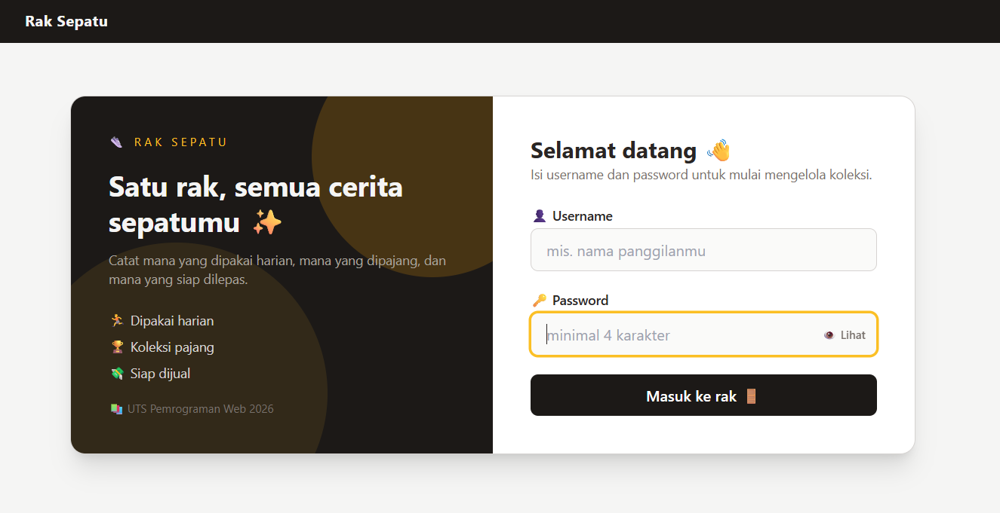
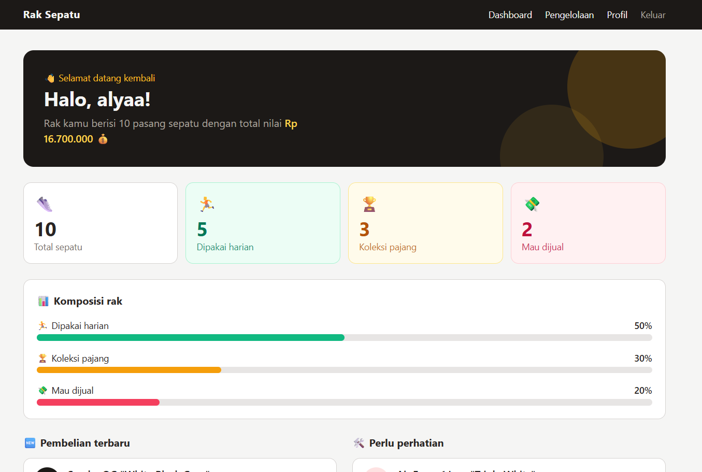
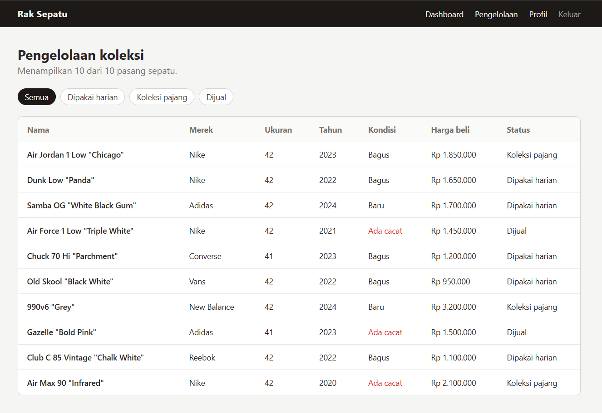
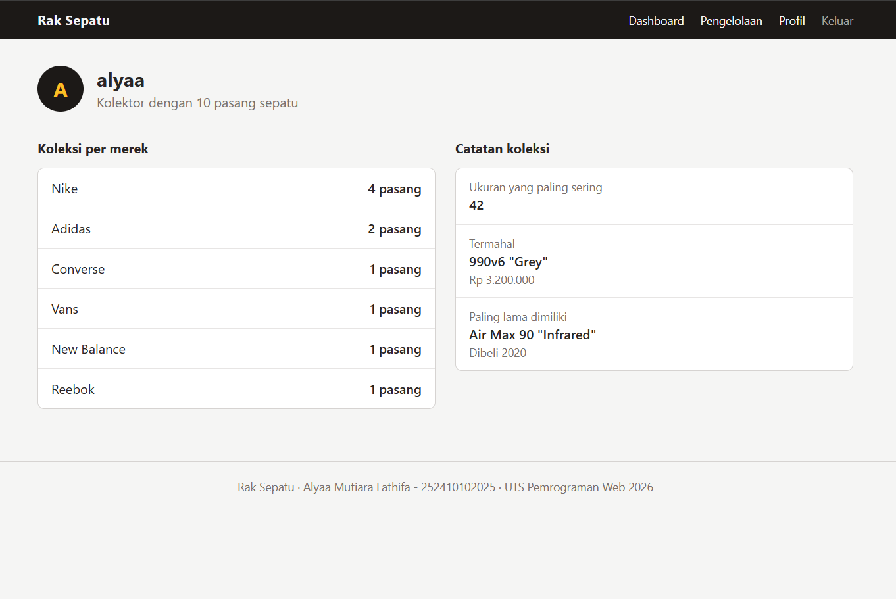

# 👟 Rak Sepatu - UTS Pemrograman Web 2026

- **Nama:** Alyaa Mutiara Lathifa
- **NIM:** 252410102025
- **Kelas:** C

## Tentang Website

Rak Sepatu adalah website untuk mencatat dan mengelola koleksi sepatu pribadi. Setelah masuk dengan username, pengguna bisa melihat ringkasan koleksi di dashboard, membuka profil kolektor yang berisi statistik per merek, dan mengelola daftar sepatu lewat halaman pengelolaan yang punya filter berdasarkan status (dipakai harian, koleksi pajang, atau dijual). Website ini dibuat dengan Laravel dan Blade, dengan data sepatu disimpan sebagai array di controller.

Tema pengelolaan yang dipilih: **koleksi sepatu**.

## Fitur

- Simulasi login dengan validasi (username minimal 3 karakter, password minimal 4 karakter).
- Username dikirim ke dashboard, profil, dan pengelolaan lewat request parameter.
- Dashboard berisi ringkasan angka, komposisi koleksi, pembelian terbaru, dan sepatu yang perlu perhatian.
- Halaman pengelolaan menampilkan daftar sepatu dalam tabel, lengkap dengan filter status.
- Halaman profil berisi statistik koleksi per merek, sepatu termahal, dan sepatu paling lama dimiliki.
- Tampilan responsif.

## Teknologi

- Laravel (MVC murni, tanpa starter kit dan tanpa database)
- Blade (`@extends`, `@section`, `@yield`, `@include`, dan x-component)
- Tailwind CSS (lewat CDN)

## Struktur Utama

```
routes/web.php
app/Http/Controllers/PageController.php
resources/views/layouts/app.blade.php
resources/views/login.blade.php
resources/views/dashboard.blade.php
resources/views/pengelolaan.blade.php
resources/views/profile.blade.php
resources/views/components/navbar.blade.php
resources/views/components/footer.blade.php
```

Data sepatu disimpan sebagai array di `PageController`, lalu dikirim ke view dan ditampilkan dengan `@foreach`.


### Login
## Screenshot

### Login


### Dashboard


### Pengelolaan


### Profile


## Cara Menjalankan

1. Clone repository ini.
2. Jalankan `composer install`.
3. Salin `.env.example` menjadi `.env`, lalu ubah `SESSION_DRIVER=file` dan `CACHE_STORE=file`.
4. Jalankan `php artisan key:generate`.
5. Jalankan `php artisan serve`, lalu buka `http://127.0.0.1:8000`.
